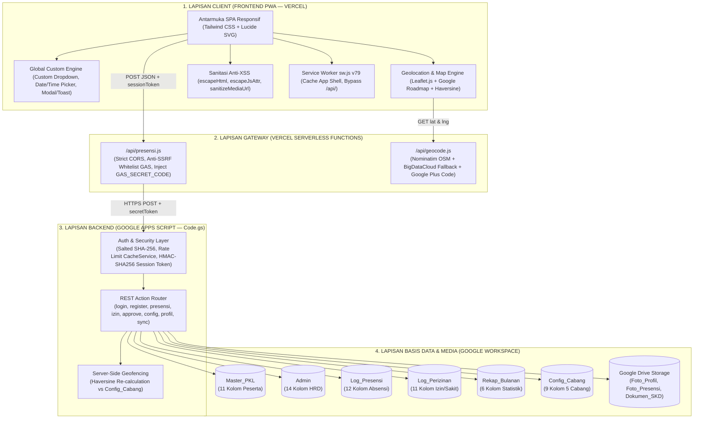
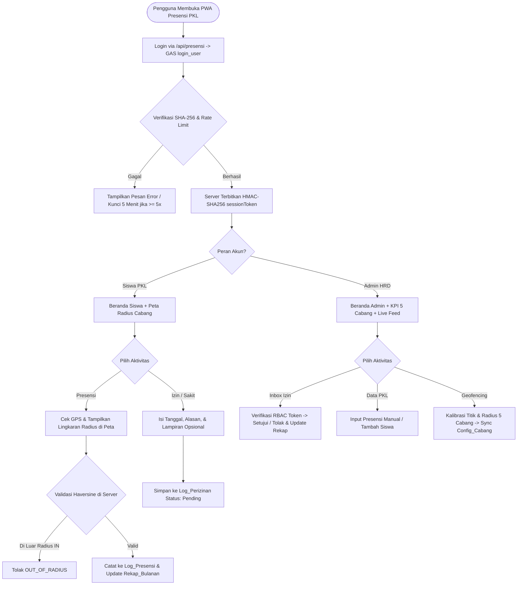

# 📍 Dokumen Spesifikasi Produk (PRD) & Panduan Teknis Arsitektur Menyeluruh
## Sistem Presensi PKL Geofencing & Monitoring Multi-Cabang (Astra Daihatsu DSO Lampung)

> **Klasifikasi:** Dokumen Resmi Spesifikasi Produk (PRD), Arsitektur Sistem, Katalog Fitur Menyeluruh, Direktori Kode Program, Materi Laporan PKL, & Blueprint Pembangunan Step-by-Step  
> **Sasaran Pembaca:** Manajemen Astra Daihatsu DSO Lampung, HRD & Personalia (PIC PKL), Pembimbing Bengkel/Workshop, Peserta PKL (Siswa SMK / Mahasiswa), System Architect, Tim Pengembang, & Dosen/Guru Pembimbing PKL  
> **Status Dokumen:** Siap Operasional (*Production-Ready Enterprise Edition — Versi 2.0 PWA v79 Terverifikasi Penuh*)  
> **Cakupan Wilayah:** 5 Cabang Resmi Astra Daihatsu Sales Operation (DSO) Lampung (`BDL_AYANI`, `BDL_SOETTA`, `BDJ_PROKLAMATOR`, `KTB_LAMPURA`, `LTM_SRIBAWONO`)  

---

# 📘 BAGIAN I: DOKUMEN SPESIFIKASI PRODUK (PRD) & ARSITEKTUR TEKNIS MENYELURUH

## 1. Ringkasan Eksekutif (Executive Summary)

### 1.1 Latar Belakang & Visi Transformasi Digital
Pengelolaan kehadiran peserta Praktik Kerja Lapangan (PKL) — baik siswa SMK (seperti Jurusan Teknik Kendaraan Ringan/Otomotif) maupun mahasiswa — di lingkungan bengkel dan dealer **PT Astra International Tbk – Daihatsu Sales Operation (DSO) Area Lampung** sebelumnya masih mengandalkan absensi manual berbasis buku daftar hadir, tanda tangan kertas, serta pelaporan izin/sakit via pesan chat yang tersebar. Pola konvensional tersebut rentan terhadap titip absen, keterlambatan rekapitulasi bulanan, kehilangan arsip surat keterangan, serta kesulitan HRD dalam memantau kehadiran peserta lintas 5 cabang secara *real-time*.

**Sistem Presensi PKL – Daihatsu DSO LAMPUNG** mentransformasi seluruh alur kehadiran, perizinan, dan rekapitulasi PKL menjadi **ekosistem aplikasi web modern berbasis Progressive Web App (PWA Mobile-First & Responsive Desktop)**. Sistem terhubung secara *real-time* (sinkronisasi 2 arah) dengan infrastruktur komputasi awan **Google Workspace** (Google Sheets 6-Sheet Database & Google Drive Cloud Storage) melalui **Vercel Serverless Reverse Proxy** berkeamanan tinggi dengan enkripsi HTTPS SSL/TLS.

### 1.2 Pilar Keunggulan Sistem (Versi 2.0 Production-Ready)
1. **Validasi Geofencing GPS Dual-Layer (Client & Server-Side Haversine):** Presensi Masuk (`IN`) divalidasi menggunakan formula geodesik Haversine terhadap koordinat dan radius resmi cabang di sheet `Config_Cabang` — baik di perangkat siswa maupun dihitung ulang secara mutlak di server (`Code.gs`) untuk mencegah bypass melalui *DevTools / Inspect Element*.
2. **Dukungan Multi-Cabang Resmi (5 Cabang Astra Daihatsu Lampung):** Mencakup `BDL_AYANI` (Ahmad Yani), `BDL_SOETTA` (Soekarno Hatta), `BDJ_PROKLAMATOR` (Bandar Jaya), `KTB_LAMPURA` (Kotabumi), dan `LTM_SRIBAWONO` (Bandar Sribawono), lengkap dengan kalibrasi titik pusat & slider radius (`30m–300m`, preset `70m`, `100m`, `150m`, `200m`) yang tersinkronisasi otomatis ke seluruh akun siswa.
3. **Peta Interaktif Real-Time dengan Lingkaran Radius Geofencing (Leaflet.js + Google Maps Tile):** Menampilkan posisi GPS siswa, titik pusat workshop berlogo Daihatsu, lingkaran area radius geofencing (hijau jika di dalam radius, merah jika di luar radius), alamat *reverse geocoding*, Google Plus Code, serta popup informasi cabang dinamis.
4. **Dual-Role System & Isolasi Hak Akses (RBAC):** Pemisahan tegas antara antarmuka **Siswa PKL (`student`)** dan **HRD / Admin (`admin`)** yang divalidasi langsung oleh server menggunakan **HMAC-SHA256 Signed Session Token**.
5. **Pengajuan Izin & Sakit Fleksibel (Lampiran Opsional):** Peserta dapat mengajukan ketidakhadiran kategori **Sakit** maupun **Izin Keperluan** dengan lampiran dokumen bukti (JPG/PNG/PDF maks. 2 MB) yang bersifat **opsional**, langsung masuk ke *Inbox Persetujuan HRD* dan otomatis memperbarui `Rekap_Bulanan` saat disetujui.
6. **Rekap Kehadiran Terstruktur & Export PDF Siap Cetak:** Menggabungkan Clock IN dan Clock OUT pada hari yang sama ke dalam 1 baris ringkas lengkap dengan kalkulasi durasi jam kerja, filter kategori/siswa, serta cetak laporan PDF berkop resmi dengan kolom tanda tangan.
7. **Executive Digital ID Card & Sinkronisasi Foto Profil Google Drive:** Kartu identitas peserta PKL bergaya eksekutif dengan normalisasi otomatis URL foto Google Drive (`drive.google.com/thumbnail?id=...`) dan fallback inisial huruf dinamis jika foto belum diunggah.
8. **Global Custom UI Engine (Bebas Popup Bawaan OS/Browser):** Seluruh `<select>` dropdown, `<input type="date|time">`, dan dialog `alert()`/`confirm()` diganti dengan komponen modal/popover kustom yang seragam, kompak, dan elegan di Android, iOS, maupun Desktop.
9. **Keamanan Aplikasi 10/10 (Enterprise Hardened):** Zero hardcoded credentials/tokens di frontend, Salted SHA-256 password hashing dengan auto-upgrade, rate limiting login (5x gagal / 5 menit), anti-SSRF pada proxy Vercel, proteksi Stored XSS (`escapeHtml` / `escapeJsAttr` / `sanitizeMediaUrl`), CORS ketat, dan pembersihan `localStorage`.
10. **Zero-Cost Serverless Architecture & PWA Standalone:** Berjalan 100% tanpa biaya sewa VPS (Vercel + Google Workspace) dan dapat diinstal langsung ke *homescreen* smartphone Android/iOS melalui Service Worker (`sw.js` v79) dengan *bypass cache* khusus rute `/api/`.

---

## 2. Perbandingan: Cara Kerja Konvensional vs. Sistem Baru (v2.0)

| Aspek Operasional | Cara Konvensional (Sebelumnya) | Menggunakan Sistem Presensi PKL (v2.0 PWA) |
| :--- | :--- | :--- |
| **Pencatatan Kehadiran Harian** | Tanda tangan manual di buku absensi kertas pos bengkel; rawan titip absen dan manipulasi jam. | **Presensi Digital GPS Geofencing (< 10 Detik)**. Wajib berada di dalam radius workshop (divalidasi di HP dan dihitung ulang di server). |
| **Pemantauan Lintas 5 Cabang** | HRD harus menunggu rekap mingguan/bulanan via WhatsApp dari masing-masing pembimbing cabang. | **Dashboard Monitoring Real-Time 5 Cabang**. Admin melihat statistik peserta, kehadiran hari ini, dan aktivitas live seluruh cabang dalam satu layar. |
| **Pengajuan Izin & Sakit** | Pesan chat WhatsApp pribadi ke pembimbing; rawan tenggelam dan tidak terdata di rekap bulanan. | **Modul Pengajuan Izin/Sakit & Inbox Persetujuan HRD**. Lampiran bukti opsional (tersimpan di Google Drive), 1-klik Setujui/Tolak yang otomatis memperbarui `Rekap_Bulanan`. |
| **Pengaturan Radius & Lokasi Bengkel** | Tidak ada batas lokasi digital yang terstandarisasi antar cabang. | **Kalibrasi GPS 1-Klik & Slider Radius (30m–300m)** khusus Admin, tersimpan di `Config_Cabang` dan langsung aktif di HP seluruh siswa cabang terkait. |
| **Pembuatan Rekap Laporan PKL** | Menghitung manual total hari hadir, sakit, izin, dan jam kerja di akhir masa PKL (memakan waktu berjam-jam). | **Rekap Otomatis & Export PDF 1-Klik**. Clock IN/OUT otomatis dipasangkan dengan kalkulasi durasi jam kerja dan format cetak resmi siap tanda tangan. |
| **Keamanan & Integritas Data** | Buku absensi fisik mudah rusak, hilang, atau dicoret; rawan manipulasi waktu. | **Cloud Database Google Sheets + 10 Lapis Keamanan** (HMAC Session Token, Salted SHA-256, Server-Side Haversine, Anti-XSS, Anti-SSRF, Rate Limiting). |
| **Pengalaman Akses di Smartphone** | Harus membuka file spreadsheet yang kecil dan sulit dioperasikan di layar HP. | **Progressive Web App (PWA) Mobile-First**. Tampilan native dengan bottom navigation, custom dropdown/kalender kompak, dan dapat diinstal ke layar utama HP. |

---

## 3. Struktur Organisasi, Hak Akses Berjenjang & Matriks Wewenang (RBAC)

Sistem menerapkan prinsip **Role-Based Access Control (RBAC)** dengan verifikasi **Signed Session Token (HMAC-SHA256)** di sisi server (`Code.gs`):

```
┌────────────────────────────────────────────────────────────────────────────────────────┐
│            STRUKTUR HAK AKSES SISTEM PRESENSI PKL ASTRA DAIHATSU LAMPUNG               │
├──────────────────────────────────────────┬─────────────────────────────────────────────┤
│ 1. ADMIN / HRD & PERSONALIA (PIC PKL)    │ • Pengawas sentral seluruh 5 cabang Lampung │
│    (Role: admin • Sheet: Admin)          │ • Melihat KPI & riwayat live seluruh siswa  │
│                                          │ • Verifikasi Inbox Persetujuan Izin/Sakit   │
│                                          │ • Kelola direktori siswa & Presensi Manual  │
│                                          │ • Kalibrasi titik pusat & radius 5 cabang   │
│                                          │ • Rekap & Export PDF seluruh peserta PKL    │
├──────────────────────────────────────────┼─────────────────────────────────────────────┤
│ 2. PESERTA PKL (SISWA SMK / MAHASISWA)   │ • Terdaftar pada salah satu dari 5 cabang   │
│    (Role: student • Sheet: Master_PKL)   │ • Data terisolasi (hanya profil & log diri) │
│                                          │ • Presensi Masuk (IN) & Selesai (OUT) GPS   │
│                                          │ • Pengajuan Izin & Sakit (lampiran opsional)│
│                                          │ • Lihat Rekap pribadi & Export PDF pribadi  │
│                                          │ • Edit Profil, Foto Avatar, & Ubah Sandi    │
│                                          │ • TERKUNCI: Tidak bisa ubah radius/approval │
└──────────────────────────────────────────┴─────────────────────────────────────────────┘
```

### 3.1 Matriks Wewenang Fitur (Authority Matrix)

| Fitur / Modul Operasional | Admin / HRD (`admin`) | Peserta PKL (`student`) | Mekanisme Proteksi Server (`Code.gs`) |
| :--- | :---: | :---: | :--- |
| **Login & Verifikasi Akun** | ✅ Ya (Sheet `Admin`) | ✅ Ya (Sheet `Master_PKL`) | Salted SHA-256 + Rate Limit 5x gagal / 5 menit. |
| **Registrasi Peserta Baru** | ✅ Tambah via Panel Admin | ✅ Registrasi Mandiri | Selalu ditetapkan role `student` (tidak bisa self-register jadi Admin). |
| **Presensi Masuk (IN) & Selesai (OUT)** | ➖ (Input Manual HRD) | ✅ Ya (Wajib GPS Radius) | Server menghitung ulang jarak Haversine terhadap `Config_Cabang`. |
| **Pengajuan Izin / Sakit** | ➖ (Sebagai Approver) | ✅ Ya (Bukti Opsional) | Tersimpan ke `Log_Perizinan` berstatus awal `Pending`. |
| **Approve / Reject Izin & Sakit** | ✅ **Khusus Admin** | ❌ **Ditolak Server** | Wajib `authSession.isAdmin === true` (HMAC verified). |
| **Input Presensi Manual HRD** | ✅ **Khusus Admin** | ❌ **Ditolak Server** | Wajib `authSession.isAdmin === true`. |
| **Kalibrasi Titik & Ubah Radius Cabang** | ✅ **Khusus Admin** | ❌ **Disembunyikan & Ditolak** | Wajib `authSession.isAdmin === true`; UI disembunyikan di akun siswa. |
| **Lihat Data Seluruh Siswa & Admin** | ✅ **Khusus Admin** | ❌ **Terisolasi per NIM** | `get_admin_data` memaksa scope siswa jika bukan sesi Admin valid. |
| **Edit Profil & Ganti Kata Sandi** | ✅ Profil Admin (`Admin`) | ✅ Profil Sendiri (`Master_PKL`) | Verifikasi kata sandi lama ke server + proteksi RBAC sheet `Admin`. |

---

## 4. Arsitektur Tiga Lapis (Frontend PWA, Serverless Proxy, & Cloud Backend)



---

## 5. Rincian Lengkap Seluruh Menu & Fitur Website

```
┌──────────────────────────────────────────────────────────────────────────────────┐
│                 PETA FITUR SISTEM PRESENSI PKL (v2.0 PRODUCTION)                 │
├───────────────────────────────┬──────────────────────────────────────────────────┤
│ 1. NAVIGASI & HEADER GLOBAL   │ • Desktop Sidebar Navy (#0d1a3a) & Mobile Bottom │
│                               │   Nav, Sticky Topbar, Role Switcher Pill, Avatar │
│                               │   Drive/Inisial, Global Copyright Footer         │
├───────────────────────────────┼──────────────────────────────────────────────────┤
│ 2. BERANDA (DASHBOARD)        │ • Hero Banner Daihatsu, 4 Kartu KPI Dinamis      │
│                               │   (Siswa vs Admin), Peta Geofencing Interaktif   │
│                               │   + Popup Cabang, Status Hari Ini / Feed Admin   │
├───────────────────────────────┼──────────────────────────────────────────────────┤
│ 3. PRESENSI (USER) /          │ • User: Live WIB Clock, Kartu Jam Masuk/Selesai, │
│    DATA SISWA PKL (ADMIN)     │   Sub-Screen 2 Peta Radius + Refresh GPS         │
│                               │ • Admin: Direktori Siswa, Tambah/Hapus Siswa,    │
│                               │   Input Presensi Manual HRD (Custom Picker)      │
├───────────────────────────────┼──────────────────────────────────────────────────┤
│ 4. IZIN & SAKIT (USER) /      │ • User: Form Sakit/Izin, Custom Date Picker,     │
│    INBOX PERSETUJUAN (ADMIN)  │   Upload Lampiran Opsional (JPG/PNG/PDF <= 2MB)  │
│                               │ • Admin: Filter Status, Preview Lampiran,        │
│                               │   1-Klik Setujui / Tolak (Sync Rekap_Bulanan)    │
├───────────────────────────────┼──────────────────────────────────────────────────┤
│ 5. REKAP KEHADIRAN & PDF      │ • Pairing Clock IN + OUT (1 Baris/Hari + Durasi),│
│                               │   Filter Kategori & Siswa, Export PDF Resmi      │
├───────────────────────────────┼──────────────────────────────────────────────────┤
│ 6. PENGATURAN & PROFIL        │ • Executive Digital ID Card, Edit Profil + Foto, │
│                               │   Ubah Kata Sandi (Verifikasi Server), Install   │
│                               │   PWA, Panel Geofencing 5 Cabang (Khusus Admin)  │
└───────────────────────────────┴──────────────────────────────────────────────────┘
```

### 5.1 Navigasi Global, Header, & Footer
1. **Desktop Sidebar (`#sidebar`):** Panel navigasi tetap warna brand Navy Astra Daihatsu (`#0d1a3a`) memuat logo resmi Daihatsu, kartu identitas sistem, 5 menu navigasi dinamis (menyesuaikan label & ikon untuk Siswa vs Admin), serta indikator status GPS presisi.
2. **Mobile Bottom Navigation Bar (`#mobile-bottom-nav`):** Navigasi bawah *fixed* dengan `safe-area-inset-bottom` untuk kenyamanan operasi satu tangan (*thumb zone*) di HP Android/iOS.
3. **Sticky Topbar Header:** Menampilkan logo Daihatsu (mobile), judul halaman dinamis (subtitle otomatis disembunyikan di `< 640px` agar judul tidak terpotong), tombol **Role Switcher** (`Siswa PKL` / `HRD Admin`), indikator GPS live (desktop), serta avatar profil yang dapat diklik ke Pengaturan.
4. **Global Footer:** Tampilan bersih satu baris (`© 2026 Sistem Presensi PKL – Daihatsu DSO LAMPUNG`) dengan ruang aman `pb-24 md:pb-8` agar tidak tertutup bottom navigation.

### 5.2 Tab 1: Beranda (Dashboard)
- **Hero Banner Astra Daihatsu:** Banner visual responsif (`h-32 sm:h-40 lg:h-48`) dan *Onboarding Notice Banner* otomatis bagi peserta baru yang belum melengkapi profil.
- **4 Kartu KPI Dinamis (`tabular-nums`):**
  - *Mode Siswa:* `Total Hadir`, `Total Sakit`, `Total Izin`, `Total Jam Kerja` (akumulasi).
  - *Mode Admin:* `Total Siswa PKL`, `Hadir Hari Ini`, `Inbox Persetujuan`, `Cabang PKL` (**5 Cabang**).
- **Peta Geofencing Interaktif (`#live-geofence-map`):** Menggunakan Leaflet.js + Google Maps Roadmap tile, marker merah berlogo Daihatsu dengan popup informasi cabang proporsional (`min-width: 210px`), titik biru posisi user, lingkaran radius geofencing, tombol cepat **Bengkel** & **Posisi Saya**, serta rincian koordinat & jarak terhitung.
- **Ringkasan Aktivitas:** Kartu status Presensi Hari Ini (untuk Siswa) atau daftar *Live Feed* Aktivitas Presensi Terkini seluruh siswa hari ini (untuk Admin).

### 5.3 Tab 2: Presensi (Siswa) & Data Siswa PKL (Admin)
- **Alur Siswa (`#student-attendance-flow` — Desktop 2 Kolom, Mobile Single-Screen Fit):**
  - *Sub-Screen 1 (Overview):* Jam digital WIB real-time (`tabular-nums`), 2 kartu status **Jam Masuk** & **Jam Selesai** (`--:--`), bar status lokasi GPS + tombol **Cek GPS**, dan tombol utama **Presensi Masuk / Presensi Selesai**.
  - *Sub-Screen 2 (Konfirmasi & Peta Lokasi):* Menampilkan detail waktu & tanggal kerja Bahasa Indonesia, peta interaktif (`#clock-flow-leaflet-map`) lengkap dengan **lingkaran radius geofencing** (hijau/merah) & titik biru pusat bengkel, alamat *reverse geocoding* + Google Plus Code, tombol **Refresh GPS**, serta tombol **Konfirmasi Presensi**.
- **Alur Admin (`#admin-data-pkl-flow` — `max-w-6xl`):**
  - 4 kartu statistik direktori peserta, tabel desktop & kartu mobile daftar siswa PKL lengkap dengan status shift hari ini (*Lengkap*, *Sedang Shift*, *Izin/Sakit*, *Belum Masuk*).
  - Tombol aksi per baris: **Lihat Rekap**, **Input Presensi Manual HR** (modal dengan Custom Dropdown & Custom Date/Time Picker), **Tambah Siswa Baru**, dan **Hapus Siswa**.

### 5.4 Tab 3: Pengajuan Izin / Sakit (Siswa) & Inbox Persetujuan (Admin)
- **Formulir Siswa (`#student-izin-form-container` — Desktop 2 Kolom):**
  - Pilihan radio **Sakit** (ikon `stethoscope`) atau **Izin Keperluan** (ikon `file-text`).
  - **Tanggal Tidak Hadir** menggunakan Custom Date Picker kompak.
  - **Alasan / Catatan Detail** (wajib diisi).
  - **Lampiran Dokumen Bukti (Opsional):** Mendukung JPG, PNG, dan PDF (maks. 2 MB) untuk Sakit maupun Izin; dapat dikirim langsung tanpa mengunggah file.
  - Panel samping **Panduan Pengajuan** di layar desktop.
- **Inbox Persetujuan Admin (`#admin-inbox-approvals-container`):**
  - Filter segmented (`Semua`, `Pending`, `Disetujui`, `Ditolak`) dengan counter jumlah dinamis.
  - Kartu permohonan menampilkan avatar inisial, nama, NIM, asal sekolah, tanggal, alasan, tombol preview lampiran (jika ada), serta tombol **Setujui** / **Tolak**.

### 5.5 Tab 4: Rekap Kehadiran & Export PDF
- Baris kontrol kompak: Filter Kategori (`Semua`, `Hadir`, `Sakit`, `Izin`), Filter Per Siswa (khusus Admin), toggle tampilan Kartu/Tabel, dan tombol **Cetak / Export PDF**.
- **Logika Pairing Harian:** Log `IN` dan `OUT` pada tanggal dan NIM yang sama digabungkan menjadi 1 entri lengkap dengan durasi kerja (`calculateWorkDuration`).
- **Template Cetak PDF (`print:`):** Menyembunyikan elemen navigasi/tombol dan menampilkan kop surat resmi Astra Daihatsu Lampung, metadata peserta, tabel kehadiran, serta area tanda tangan Peserta PKL & Pembimbing Bengkel.

### 5.6 Tab 5: Pengaturan & Profil (12-Kolom Bento Grid)
- **Executive Digital ID Card:** Kartu identitas resmi peserta/admin dengan header Navy gradient, avatar Google Drive (dengan fallback inisial dinamis), badge `Terverifikasi`, serta rincian identitas lengkap.
- **Sub-Halaman Edit Profil & Ubah Kata Sandi:** Tombol simpan responsif (`h-12 min-h-[48px]`), kompresi foto profil otomatis `256px` via Canvas sebelum upload ke Drive, dan verifikasi kata sandi lama langsung ke server.
- **Panel Titik Pusat & Radius Bengkel (Khusus Admin):**
  - Dropdown pilih 5 cabang resmi, input Latitude & Longitude, slider radius (`30m–300m`) + 4 tombol preset dinamis (`70m`, `100m`, `150m`, `200m`) dengan highlight aktif yang persisten saat reload.
  - Tombol **Gunakan Lokasi Saya Saat Ini** (Kalibrasi GPS khusus Admin), **Reset Default**, dan **Simpan Parameter Geofencing** (sinkron ke `Config_Cabang` & seluruh siswa).
- **Instalasi PWA & Manajemen Sesi:** Tombol instalasi WebAPK Android/iOS dan tombol **Keluar Akun** full-width yang membersihkan seluruh token sesi & cache sensitif.

---

## 6. Kamus Lengkap & Direktori Kode Program (Codebase & Function Directory)

### 6.1 Struktur Direktori Repositori
```text
presensi-pkl/
├── index.html                        # Aplikasi SPA utama (HTML5, CSS, JS, Custom UI Engines)
├── sw.js                             # Service Worker PWA (v79: cache aset statis + bypass /api/)
├── manifest.json                     # Web App Manifest (standalone, icons 192/512/maskable)
├── vercel.json                       # Header Cache-Control untuk sw.js & manifest.json
├── api/
│   ├── presensi.js                   # Vercel Serverless Proxy (Strict CORS, Anti-SSRF, Secret Injector)
│   └── geocode.js                    # Vercel Reverse Geocoding (Nominatim + BigDataCloud + Plus Code)
├── Image/
│   ├── Logo-Daihatsu.png             # Logo resmi Astra Daihatsu
│   ├── Logo-PWA.png                  # Emblem pin peta & PWA
│   ├── Picture-Hero.png              # Banner dashboard "Disiplin Hari Ini, Untuk Masa Depan Nanti"
│   └── icon-*.png                    # Set ikon PWA (192, 512, maskable, apple-touch-icon)
├── Code.gs                           # Backend Google Apps Script (lokal; tidak di-commit ke Git publik)
└── spesifikasi_produk_presensi_pkl.md# Dokumen PRD & Panduan Lengkap ini
```

### 6.2 Fungsi Utama di `index.html` (Frontend SPA)
| Modul | Nama Fungsi | Deskripsi Fungsional |
| :--- | :--- | :--- |
| **Konfigurasi & Cabang** | `DAIHATSU_BRANCHES_DEFAULT`, `getBranchConfig(key)`, `applyCustomBranchConfigs(cfg)`, `setAppBranch(key)` | Mengelola 5 cabang resmi Lampung, alias kompatibilitas, serta sinkronisasi koordinat & radius dari cloud database. |
| **Keamanan Frontend** | `getAuthSessionToken()`, `escapeHtml(val)`, `escapeJsAttr(val)`, `sanitizeMediaUrl(url)` | Pengambilan token sesi HMAC, sanitasi anti-XSS seluruh teks & atribut inline, serta validasi URL media aman. |
| **Sinkronisasi Cloud** | `syncDataFromDatabase(showToast)`, `normalizeDriveImageUrl(url)`, `normalizeSheetDate(val)`, `normalizeSheetTime(val)` | Sinkronisasi 2 arah via `POST /api/presensi` (`cache: 'no-store'`), normalisasi link foto Google Drive ke endpoint thumbnail, dan normalisasi format tanggal/jam WIB. |
| **Peta & Geofencing** | `initLiveMap()`, `updateMapPositions()`, `checkGPS(showNotice)`, `calculateDistance(lat1, lng1, lat2, lng2)`, `initOrUpdateClockFlowMap()` | Inisialisasi peta Leaflet.js (Dashboard & Presensi), menggambar lingkaran radius geofencing, menghitung jarak Haversine, dan memanggil `/api/geocode`. |
| **Alur Presensi** | `updateOnlineAttendanceUI()`, `openClockFlow(type)`, `submitAttendance()` | Mengelola status Jam Masuk/Selesai, validasi radius client + penanganan penolakan `OUT_OF_RADIUS` dari server, serta penyimpanan log. |
| **Izin & Approval** | `updateFormIzinType()`, `submitPerizinan(e)`, `renderInboxApprovals()`, `handleApprovePermit(izinId, status)` | Formulir pengajuan Sakit/Izin (lampiran opsional base64) dan panel verifikasi approval HRD. |
| **Rekap & Dashboard** | `renderDashboardStats()`, `renderRekapTable()`, `calculateWorkDuration(inT, outT)`, `exportRekapPDF()` | Kalkulasi KPI User & Admin, pairing log IN/OUT per hari, filter kategori/siswa, dan cetak PDF. |
| **Admin & Role** | `applyUserRoleUI(role)`, `renderAdminRecentAttendance()`, `renderAdminStudentsTable()`, `submitManualAttendance(e)` | Pengaturan tampilan 5 menu berdasarkan peran (`admin` vs `student`), direktori siswa, dan input presensi manual HRD. |
| **Profil & Pengaturan** | `updateProfileDisplay()`, `handleAvatarUpload(e)`, `saveProfile()`, `saveNewPassword()`, `setRadiusPreset(val)`, `updateRadiusPresetActiveUI(val)`, `calibrateCurrentLocation()` | Pengelolaan profil, kompresi avatar Canvas 256px, verifikasi ganti sandi ke server, preset radius dinamis, dan kalibrasi GPS khusus Admin. |
| **Autentikasi** | `handleLoginSubmit(e)`, `handleRegisterSubmit(e)`, `handleLogout()` | Login 100% via backend (`login_user`), registrasi peserta baru, dan pembersihan sesi/foto/cache saat logout. |
| **Custom UI Engine** | `initGlobalCustomDropdownSystem()`, `initGlobalCustomDateTimePickers()`, `showAppAlert()`, `showAppConfirm()`, `showAppToast()` | Mengganti seluruh `<select>`, `<input type="date|time">`, `alert()`, dan `confirm()` bawaan OS dengan popup kustom kompak & responsif. |

### 6.3 Fungsi Utama di `api/presensi.js` & `api/geocode.js` (Vercel Serverless)
- **`api/presensi.js`:**
  - Validasi `origin` CORS ketat (`*.vercel.app`, `localhost`, atau `process.env.ALLOWED_ORIGIN`).
  - `isAllowedGasUrl(rawUrl)`: Validasi anti-SSRF (hanya mengizinkan `https://script.google.com/macros/s/...`).
  - Prioritas `process.env.GAS_URL` dan injeksi otomatis `process.env.GAS_SECRET_CODE` di sisi server (hanya ke URL env tepercaya).
- **`api/geocode.js`:**
  - Reverse geocoding alamat jalan/kecamatan/kota via OpenStreetMap Nominatim dengan fallback otomatis ke BigDataCloud API.
  - `encodePlusCode(lat, lng)`: Menghasilkan Google Plus Code (Open Location Code) presisi.

### 6.4 Fungsi Utama di `Code.gs` (Google Apps Script Backend)
- **Keamanan & Kriptografi:** `createSignedSessionToken(nim, role)`, `verifySignedSessionToken(token)`, `hashPassword(plainPwd)`, `verifyPassword(inputPwd, storedPwd)`, `computeHaversineMeters(lat1, lng1, lat2, lng2)`.
- **HTTP Handlers:** `doGet(e)` (status ping & inisialisasi terproteksi token) dan `doPost(e)` (router untuk 9 action: `presensi`, `update_profil`, `izin_sakit`, `approve_izin`, `get_admin_data`, `presensi_manual`, `register_siswa`, `login_user`, `save_branch_config`).
- **Database Helpers:** `setupDatabaseSheets()`, `createMasterPKLSheet()`, `createAdminSheet()`, `createLogPresensiSheet()`, `createLogPerizinanSheet()`, `createRekapBulananSheet()`, `createConfigCabangSheet()`, `getBranchConfigsFromSheet()`, `updateRekapBulanan()`.

---

## 7. Spesifikasi Lengkap Basis Data (Google Sheets 6-Sheet & Google Drive)

### 7.1 Sheet 1: `Master_PKL` (11 Kolom — Data Peserta PKL)
| Kolom | Nama Header | Tipe Data | Contoh Isi | Fungsi |
| :-: | :--- | :--- | :--- | :--- |
| **A** | `NIM / NISN` | String (PK) | `654553` | ID unik peserta PKL |
| **B** | `Nama Lengkap` | String | `Sunoo` | Nama lengkap peserta |
| **C** | `Asal Sekolah / Kampus` | String | `SMKN 2 Bandar Lampung` | Instansi pendidikan |
| **D** | `Jurusan / Program` | String | `Teknik Kendaraan Ringan (TKR)` | Program keahlian |
| **E** | `URL Foto Profil` | URL Drive | `https://drive.google.com/file/d/...` | Foto profil peserta |
| **F** | `Status PKL` | String | `Aktif` | Status keaktifan magang |
| **G** | `Role` | String | `anak PKL` | Peran akun |
| **H** | `Username` | String | `Sunoo` | Username login |
| **I** | `Password` | Hash String | `sha256$<salt>$<hex>` | Kata sandi ter-hash |
| **J** | `Cabang` | String | `BDL_AYANI` | Kode cabang penempatan |
| **K** | `Terakhir Diupdate` | DateTime | `27/11/2026 10:15:00` | Audit timestamp |

### 7.2 Sheet 2: `Admin` (14 Kolom — Data Akun HRD / Pembimbing)
| Kolom | Nama Header | Keterangan |
| :-: | :--- | :--- |
| **A–D** | `NIP_ID`, `Nama Lengkap`, `Jabatan`, `Divisi_Bagian` | Identitas resmi HRD / PIC PKL |
| **E–F** | `No_WhatsApp`, `Email` | Kontak resmi koordinator |
| **G–H** | `UserName`, `Password` | Kredensial login (`sha256$<salt>$<hex>`) |
| **I–K** | `Role_Akses`, `Cabang_Tugas`, `Status_Akun` | `Super Admin`, `Semua Cabang (Pusat)`, `Aktif` |
| **L–N** | `URL Foto Profil`, `Waktu Dibuat`, `Terakhir Login` | Avatar Drive & log aktivitas login |

### 7.3 Sheet 3: `Log_Presensi` (12 Kolom — Transaksi Kehadiran Harian)
| Kolom | Nama Header | Contoh Isi | Keterangan |
| :-: | :--- | :--- | :--- |
| **A** | `Log_ID` | `ABS-20261127-654553-IN` | ID transaksi presensi |
| **B** | `Server Timestamp` | `27/11/2026 07:35:04` | Waktu resmi server WIB |
| **C** | `Tanggal` | `2026-11-27` | Format ISO `YYYY-MM-DD` |
| **D** | `Waktu` | `07:35:04 WIB` | Jam presensi WIB |
| **E–G** | `NIM_NISN`, `Nama Lengkap`, `Asal Sekolah` | `654553`, `Sunoo`, `SMKN 2...` | Identitas peserta |
| **H** | `Tipe Absen` | `IN` / `OUT` | Masuk atau Selesai |
| **I** | `Koordinat GPS` | `-5.421083, 105.252908` | Koordinat WGS84 |
| **J** | `Jarak Ke Bengkel (m)` | `15` | Jarak hasil kalkulasi server |
| **K** | `Status Geofencing` | `VALID_IN` / `VALID_OUT` / `FLAG_OUT_RADIUS` / `Disetujui Manual HR` | Status verifikasi radius |
| **L** | `URL Foto Bukti` | `-` atau URL Drive | Tautan foto bukti (jika ada) |

### 7.4 Sheet 4: `Log_Perizinan` (11 Kolom — Pengajuan Sakit & Izin)
`Izin_ID` (`IZN-YYYYMMDD-NIM`), `Timestamp`, `Tanggal Izin`, `NIM_NISN`, `Nama Lengkap`, `Kategori` (`Sakit`/`Izin`), `Alasan`, `URL Dokumen SKD (Drive)` *(opsional, `-` jika kosong)*, `Status Approval` (`Pending`/`Disetujui`/`Ditolak`), `Disetujui Oleh`, `Catatan Approver`.

### 7.5 Sheet 5: `Rekap_Bulanan` (6 Kolom — Statistik Kehadiran)
`NIM_NISN`, `Nama Lengkap`, `Total Hadir`, `Total Sakit`, `Total Izin`, `Persentase Kehadiran`.

### 7.6 Sheet 6: `Config_Cabang` (9 Kolom — Parameter Geofencing 5 Cabang)
`ID_Cabang`, `Nama Cabang Workshop`, `Kota / Wilayah`, `Alamat Lengkap`, `Latitude`, `Longitude`, `Radius_Meter`, `Terakhir Diupdate`, `Diupdate Oleh`.

---

## 8. Parameter Geofencing 5 Cabang Resmi & Rumus Haversine

| No | Kode ID | Nama Cabang Resmi | Wilayah | Latitude | Longitude | Radius Default |
| :-: | :--- | :--- | :--- | :-: | :-: | :-: |
| **1** | `BDL_AYANI` | Astra Daihatsu Lampung - Ahmad Yani | Bandar Lampung Pusat | `-5.421220` | `105.252890` | `150 m` |
| **2** | `BDL_SOETTA` | Astra Daihatsu Lampung - Soekarno Hatta | Bypass Bandar Lampung | `-5.393713` | `105.288628` | `150 m` |
| **3** | `BDJ_PROKLAMATOR` | Astra Daihatsu Lampung - Bandar Jaya | Lampung Tengah | `-4.950139` | `105.215034` | `150 m` |
| **4** | `KTB_LAMPURA` | Astra Daihatsu Lampung Utara - Kotabumi | Kotabumi | `-4.844410` | `104.909920` | `150 m` |
| **5** | `LTM_SRIBAWONO` | Astra Daihatsu Lampung Timur - Bandar Sribawono | Bandar Sribawono | `-5.311915` | `105.750210` | `150 m` |

### Rumus Geodesik Haversine (Implementasi Client & Server)
$$d = 2R \cdot \arcsin\left(\sqrt{\sin^2\left(\frac{\Delta \varphi}{2}\right) + \cos(\varphi_1)\cos(\varphi_2)\sin^2\left(\frac{\Delta \lambda}{2}\right)}\right)$$
*dengan $R = 6.371.000\text{ meter}$ (jari-jari bumi).*

---

## 9. Alur Kerja Operasional (SOP Siswa PKL & Admin HRD)



---

## 10. Keamanan Sistem (10/10 Kontrol) & Sistem Desain UI/UX

### 10.1 Ringkasan 10 Lapis Keamanan Terverifikasi
1. **Zero Hardcoded Credentials/Tokens di Frontend:** Login & ganti sandi 100% diverifikasi server; `GAS_SECRET_CODE` hanya ada di Vercel Env Var.
2. **Penghapusan Kebocoran Password & Data Scoping:** API tidak pernah mengembalikan field `password`; akun siswa hanya menerima data miliknya sendiri.
3. **HMAC-SHA256 Signed Session Token & RBAC Server:** Seluruh aksi Admin (`approve_izin`, `presensi_manual`, `save_branch_config`, edit `Admin`) diverifikasi tanda tangan kriptografinya di `Code.gs`.
4. **Server-Side Geofencing Validation:** Jarak Haversine dihitung ulang di server terhadap `Config_Cabang` (anti-bypass DevTools).
5. **Anti-SSRF Proxy:** `api/presensi.js` memprioritaskan `GAS_URL` server dan memblokir domain non-Google Apps Script.
6. **Proteksi Stored XSS:** Seluruh rendering `.innerHTML` data user dibungkus `escapeHtml()`, `escapeJsAttr()`, dan `sanitizeMediaUrl()`.
7. **Pembersihan `localStorage`:** Password & token rahasia tidak pernah disimpan di `localStorage`; sesi dibersihkan total saat logout.
8. **CORS Ketat:** Hanya mengizinkan origin resmi (`*.vercel.app`, `localhost`, `ALLOWED_ORIGIN`).
9. **Salted SHA-256 Password Hashing & Login Rate Limiting:** Hash otomatis (`sha256$<salt>$<hex>`) + batas 5x gagal login / 5 menit.
10. **Tes Koneksi Aman:** Uji koneksi via `GET /api/presensi` tanpa token di URL query string.

### 10.2 Sistem Desain UI/UX (Design Tokens)
- **Palet Warna Resmi:** Brand Navy `#0d1a3a`, Primary Blue `#1d4ed8` (Hover `#1e40af`), Daihatsu Red `#dc2626`, Semantic Emerald `#10b981`, Amber `#d97706`, Slate `#0f172a`–`#64748b` (WCAG AA).
- **Tipografi:** `Plus Jakarta Sans` (400–800) dengan `tabular-nums` pada seluruh angka/jam/KPI.
- **Ikonografi:** 100% ikon vektor **Lucide SVG** (0 emoji mentah di antarmuka).
- **Standar Komponen:** Card `rounded-2xl`, Button/Input `rounded-xl` (tinggi minimal `40px–48px`), Badge `rounded-full`, Global Custom Dropdown & Date/Time Picker.

---

## 11. Lembar Pengesahan & Kontak Dukungan Resmi
* **Penanggung Jawab Sistem:** Tim Pengembang & HRD Personalia (PIC PKL) Astra Daihatsu DSO Lampung  
* **Pusat Operasional:** Astra Daihatsu Lampung – Ahmad Yani (Bandar Lampung Pusat)  
* **Cakupan Cabang:** `BDL_AYANI`, `BDL_SOETTA`, `BDJ_PROKLAMATOR`, `KTB_LAMPURA`, `LTM_SRIBAWONO`  
* **Status Dokumen:** Disetujui untuk Operasional Penuh (*Versi 2.0 Production-Ready PWA v79*)  

---

# 🎓 BAGIAN II: MATERI & PANDUAN PENYUSUNAN LAPORAN PKL (FORMAT AKADEMIK)

> **Catatan Akademik:** Bagian ini disusun mengikuti standar penulisan laporan PKL / Magang jurusan Teknik Informatika, Sistem Informasi, maupun SMK RPL/TKJ agar siap digunakan langsung untuk penyusunan naskah laporan dan sidang PKL.

---

## BAB I: PENDAHULUAN

### 1.1 Latar Belakang Masalah
PT Astra International Tbk – Daihatsu Sales Operation (DSO) Area Lampung secara rutin menerima peserta Praktik Kerja Lapangan (PKL) dari berbagai SMK dan Perguruan Tinggi yang ditempatkan di 5 cabang resmi wilayah Lampung. Dalam operasional harian, pengelolaan absensi peserta PKL yang masih dilakukan secara manual (buku daftar hadir kertas dan konfirmasi izin melalui pesan chat) menimbulkan beberapa permasalahan:
1. **Kerentanan Titip Absen & Manipulasi Waktu:** Absensi kertas tidak memverifikasi lokasi fisik kehadiran peserta di area workshop pada jam masuk.
2. **Kesulitan Pemantauan Lintas Cabang:** HRD dan pembimbing cabang tidak memiliki dashboard terpusat untuk memantau kehadiran peserta secara *real-time*.
3. **Pengarsipan Izin/Sakit Tidak Terstruktur:** Permohonan izin/sakit via chat pribadi sering terlewat saat rekapitulasi akhir bulan.
4. **Rekapitulasi Laporan Manual Memakan Waktu:** Perhitungan total hadir, sakit, izin, dan akumulasi jam kerja di akhir periode PKL membutuhkan waktu lama dan rentan salah hitung.

Untuk menjawab kebutuhan tersebut, dirancang dan dibangun **Sistem Presensi PKL Berbasis Geofencing GPS dan Progressive Web App (PWA)** yang terintegrasi penuh dengan Google Workspace dan Vercel Serverless.

### 1.2 Identifikasi Masalah
1. Belum adanya validasi lokasi berbasis GPS geofencing untuk memastikan peserta benar-benar berada di area bengkel saat absen masuk.
2. Belum adanya sistem pelaporan izin dan sakit digital dengan alur persetujuan (*approval workflow*) terpusat untuk HRD.
3. Belum adanya rekapitulasi otomatis yang memasangkan jam masuk, jam selesai, durasi kerja, dan ekspor PDF siap cetak.
4. Belum adanya mekanisme keamanan aplikasi yang melindungi data pribadi peserta dan mencegah manipulasi presensi melalui browser.

### 1.3 Rumusan Masalah
1. Bagaimana merancang aplikasi presensi PKL berbasis Progressive Web App (PWA) yang responsif di perangkat mobile dan desktop tanpa memerlukan biaya sewa server?
2. Bagaimana menerapkan validasi geofencing GPS menggunakan rumus Haversine pada sisi client dan server untuk 5 cabang Astra Daihatsu Lampung?
3. Bagaimana membangun sistem dual-role (Peserta PKL & Admin HRD) yang aman menggunakan HMAC-SHA256 Signed Session Token, Salted SHA-256, dan proteksi XSS/SSRF?
4. Bagaimana menyediakan fitur perizinan digital, rekapitulasi otomatis, dan ekspor laporan PDF yang akurat?

### 1.4 Batasan Masalah
1. Sistem difokuskan pada pengelolaan presensi, perizinan, profil peserta, dan rekapitulasi PKL di 5 cabang resmi Astra Daihatsu DSO Lampung (`BDL_AYANI`, `BDL_SOETTA`, `BDJ_PROKLAMATOR`, `KTB_LAMPURA`, `LTM_SRIBAWONO`).
2. Antarmuka dibangun sebagai Single Page Application (SPA) PWA menggunakan HTML5, Tailwind CSS, Vanilla JavaScript, dan Leaflet.js yang di-hosting di Vercel.
3. Backend menggunakan Google Apps Script (`Code.gs`) dengan basis data Google Sheets (6 tab) dan penyimpanan media Google Drive (3 folder).
4. Peran pengguna terbagi menjadi 2 level akses: **Admin / HRD (`admin`)** dan **Peserta PKL (`student`)**.

### 1.5 Tujuan & Manfaat PKL
- **Tujuan:** Membangun sistem presensi geofencing real-time yang akurat, aman, mudah digunakan di HP/PC, serta mengotomasi rekapitulasi kehadiran dan persetujuan izin/sakit PKL.
- **Manfaat bagi Peserta PKL:** Mempermudah absensi harian, pengajuan izin/sakit, dan mengunduh bukti rekap kehadiran PDF untuk syarat laporan sekolah/kampus.
- **Manfaat bagi Perusahaan (Astra Daihatsu):** Meningkatkan kedisiplinan peserta PKL, memudahkan pengawasan HRD lintas 5 cabang, dan mewujudkan administrasi PKL tanpa kertas (*paperless*).
- **Manfaat bagi Akademisi:** Menjadi referensi implementasi arsitektur Serverless PWA, Geolocation Haversine, dan Application Security modern.

---

## BAB II: GAMBARAN UMUM INSTANSI PERUSAHAAN

### 2.1 Profil PT Astra International Tbk – Daihatsu Sales Operation (DSO) Lampung
PT Astra International Tbk – Daihatsu Sales Operation (DSO) merupakan distributor resmi penjualan, servis bengkel, dan suku cadang kendaraan Daihatsu di Indonesia. Di Provinsi Lampung, DSO Lampung membawahi 5 cabang operasional resmi:
1. **Astra Daihatsu Lampung – Ahmad Yani** (`BDL_AYANI`, Bandar Lampung Pusat)
2. **Astra Daihatsu Lampung – Soekarno Hatta** (`BDL_SOETTA`, Bypass Bandar Lampung)
3. **Astra Daihatsu Lampung – Bandar Jaya** (`BDJ_PROKLAMATOR`, Lampung Tengah)
4. **Astra Daihatsu Lampung Utara – Kotabumi** (`KTB_LAMPURA`, Lampung Utara)
5. **Astra Daihatsu Lampung Timur – Bandar Sribawono** (`LTM_SRIBAWONO`, Lampung Timur)

### 2.2 Visi, Misi, & Falsafah Catur Dharma Astra
- **Visi:** Menjadi salah satu perusahaan dengan pengelolaan terbaik di Asia Pasifik dengan pertumbuhan berkelanjutan.
- **Falsafah Catur Dharma Astra:** (1) Menjadi Milik yang Bermanfaat bagi Bangsa dan Negara, (2) Memberikan Pelayanan Terbaik kepada Pelanggan, (3) Menghargai Individu dan Membina Kerja Sama, (4) Senantiasa Berusaha Mencapai yang Terbaik.

---

## BAB III: ANALISIS KEBUTUHAN & METODOLOGI PERANCANGAN

### 3.1 Metodologi Pengembangan (Agile SDLC)
Pengembangan dilakukan secara iteratif melalui 5 tahapan: **Analisis Kebutuhan** (observasi alur absensi bengkel), **Perancangan Sistem** (skema 6 sheet, wireframe mobile-first, arsitektur proxy), **Implementasi Kode**, **Audit & Pengujian** (Fungsional, UI/UX, dan Keamanan 10 poin), serta **Deployment Produksi** ke Vercel & Google Apps Script.

### 3.2 Kebutuhan Fungsional & Non-Fungsional
- **Fungsional:** `F-01` Autentikasi Dual-Role (Admin & Siswa), `F-02` Registrasi & Digital ID Card Profil, `F-03` Presensi Masuk/Selesai GPS Geofencing dengan Peta & Lingkaran Radius, `F-04` Pengajuan Izin/Sakit (lampiran opsional), `F-05` Inbox Persetujuan HRD, `F-06` Direktori Siswa & Presensi Manual HRD, `F-07` Kalibrasi & Pengaturan Radius 5 Cabang, `F-08` Rekap Otomatis & Export PDF.
- **Non-Fungsional:** `NF-01` Responsif Mobile-First & Desktop 2 Kolom, `NF-02` Instalasi PWA Standalone, `NF-03` Waktu muat cepat & sinkronisasi live (`no-store`), `NF-04` Keamanan 10 lapis (HMAC RBAC, Salted SHA-256, Anti-XSS, Anti-SSRF, Server-Side Haversine), `NF-05` Zero-cost serverless hosting.

---

## BAB IV: IMPLEMENTASI & HASIL PENGUJIAN

### 4.1 Tabel Pengujian Black Box Testing (15 Skenario Terverifikasi)

| No | Skenario Pengujian | Aksi Uji | Ekspektasi Hasil | Hasil Nyata | Status |
| :-: | :--- | :--- | :--- | :--- | :-: |
| **1** | Login Siswa PKL Valid | Input NIM/Username & password valid | Masuk ke Beranda Siswa, menerima `sessionToken`, data terisolasi NIM sendiri | Sesuai Ekspektasi | **VALID** |
| **2** | Login Admin HRD Valid | Input NIP/Username & password Admin | Masuk ke Dashboard Admin (KPI 5 Cabang, Inbox, Data PKL, Geofencing Admin) | Sesuai Ekspektasi | **VALID** |
| **3** | Rate Limiting Login | Salah input password 5x berturut-turut | Server mengembalikan error `RATE_LIMITED`, akun terkunci sementara 5 menit | Sesuai Ekspektasi | **VALID** |
| **4** | Presensi Masuk Dalam Radius | Klik Presensi Masuk saat jarak 15 m (<= radius) | Peta tampilkan lingkaran radius hijau; server validasi Haversine & catat `VALID_IN` | Sesuai Ekspektasi | **VALID** |
| **5** | Presensi Masuk Di Luar Radius | Simulasi/posisi di luar radius resmi cabang | Ditolak client & ditolak server (`OUT_OF_RADIUS`), log lokal tidak tersimpan | Sesuai Ekspektasi | **VALID** |
| **6** | Presensi Selesai (Clock OUT) | Klik Presensi Selesai setelah Clock IN | Tercatat `VALID_OUT`/`FLAG_OUT_RADIUS`, durasi jam kerja otomatis terhitung di Rekap | Sesuai Ekspektasi | **VALID** |
| **7** | Pengajuan Sakit Tanpa Lampiran | Pilih Sakit, isi tanggal & alasan tanpa file | Formulir terkirim sukses sebagai kategori `Sakit` (lampiran opsional) ke `Log_Perizinan` | Sesuai Ekspektasi | **VALID** |
| **8** | Pengajuan Izin dengan PDF/Foto | Pilih Izin + unggah file PDF/JPG <= 2 MB | File terunggah ke Drive `Dokumen_SKD_PKL` dengan MIME type benar & tautan tersimpan | Sesuai Ekspektasi | **VALID** |
| **9** | Approval Izin oleh Admin | Admin klik "Setujui" pada Inbox Persetujuan | Status berubah `Disetujui`, nama approver tercatat, `Rekap_Bulanan` bertambah | Sesuai Ekspektasi | **VALID** |
| **10**| Proteksi RBAC Aksi Admin | Kirim request `approve_izin` tanpa token Admin | Server menolak dengan kode `UNAUTHORIZED` | Sesuai Ekspektasi | **VALID** |
| **11**| Input Presensi Manual HRD | Admin input absen manual via Custom Picker | Tercatat di `Log_Presensi` lengkap dengan instansi & status `Disetujui Manual HR` | Sesuai Ekspektasi | **VALID** |
| **12**| Simpan Radius 70m & Reload | Admin pilih preset `70m`, simpan, lalu reload | Radius tersimpan di `Config_Cabang`, tetap `70m` setelah reload & tombol `70m` aktif biru | Sesuai Ekspektasi | **VALID** |
| **13**| Ganti Foto Profil & Logout | Upload avatar siswa, lalu logout & login Admin | Avatar siswa tersinkron ke Drive; saat login Admin foto bersih (tidak terbawa foto siswa) | Sesuai Ekspektasi | **VALID** |
| **14**| Uji Sanitasi Anti-XSS | Input karakter `<script>` pada kolom Alasan | Teks ter-escape aman sebagai teks biasa di Inbox Admin (tidak mengeksekusi skrip) | Sesuai Ekspektasi | **VALID** |
| **15**| Export PDF & Instalasi PWA | Klik Export PDF di Rekap & Install PWA di Chrome | Format laporan PDF rapi siap cetak; aplikasi terpasang standalone di layar utama HP | Sesuai Ekspektasi | **VALID** |

### 4.2 Matriks Evaluasi Efisiensi Operasional (Sebelum vs Sesudah)

| Parameter Operasional | Sebelum Sistem (Manual) | Setelah Sistem Presensi PKL (v2.0) | Peningkatan |
| :--- | :--- | :--- | :---: |
| **Waktu Absensi Harian** | 2–5 menit (antre buku absensi) | **< 10 Detik** (1-tap GPS + Konfirmasi) | **~95% Lebih Cepat** |
| **Validasi Kehadiran Fisik** | Rawan titip absen | **100% Terverifikasi GPS Client & Server** | **Anti-Titip Absen** |
| **Pengajuan & Approval Izin** | Chat manual tidak terarsip | **Real-Time Inbox HRD + Arsip Google Drive** | **100% Terdokumentasi** |
| **Pembuatan Rekap Bulanan** | 1–3 jam hitung manual di akhir bulan | **Otomatis Real-Time + Export PDF 1-Klik** | **Hemat 100% Waktu Rekap** |
| **Biaya Infrastruktur Server** | Perlu sewa VPS jika sistem konvensional | **Rp 0 / Bulan (Vercel + Google Workspace)** | **100% Efisiensi Biaya** |

---

## BAB V: KESIMPULAN & SARAN

### 5.1 Kesimpulan
1. Sistem Presensi PKL berbasis PWA dan Geofencing GPS berhasil dibangun dan dioperasikan untuk 5 cabang resmi Astra Daihatsu DSO Lampung tanpa biaya server bulanan.
2. Validasi Haversine dua lapis (client & server) beserta tampilan lingkaran radius pada peta menjamin keakuratan kehadiran fisik peserta di area workshop.
3. Implementasi 10 kontrol keamanan (HMAC-SHA256 RBAC, Salted SHA-256, Rate Limiting, Anti-SSRF, Anti-XSS, dan isolasi data per peran) memastikan data peserta dan kendali HRD terlindungi dengan baik.
4. Seluruh 15 skenario pengujian *Black Box Testing* berstatus **VALID**, dan sistem secara nyata mempercepat pencatatan kehadiran serta rekapitulasi laporan PKL.

### 5.2 Saran Pengembangan Lanjutan
1. Penambahan notifikasi otomatis (WhatsApp Gateway / Email) ketika pengajuan izin/sakit disetujui atau ditolak HRD.
2. Integrasi pengingat otomatis (*push notification*) menjelang jam masuk dan jam pulang shift PKL.
3. Penambahan fitur logbook kegiatan harian (*jurnal PKL digital*) agar laporan kegiatan dan absensi terintegrasi dalam satu dokumen PDF akhir periode.

---

# 🛠️ BAGIAN III: PANDUAN LENGKAP CARA MEMBUAT WEBSITE INI DARI AWAL (*STEP-BY-STEP DEVELOPMENT BLUEPRINT*)

Panduan langkah demi langkah untuk membangun ulang atau mereplikasi seluruh Sistem Presensi PKL ini dari nol hingga produksi:

### LANGKAH 1: Persiapan Lingkungan Kerja (*Development Environment*)
1. Siapkan **Visual Studio Code**, **Git CLI**, **Node.js (v18+)**, dan browser **Google Chrome** (dengan DevTools).
2. Siapkan akun **Google** (untuk Google Sheets, Google Drive, dan Google Apps Script), akun **GitHub**, dan akun **Vercel**.

### LANGKAH 2: Pembuatan Database Google Sheets & Folder Google Drive
1. Buat **Google Spreadsheet** baru bernama `Database Presensi PKL`, lalu salin **Spreadsheet ID** dari URL browser.
2. Buat 3 folder di Google Drive (`Foto_Presensi_PKL`, `Foto_Profil_PKL`, `Dokumen_SKD_PKL`), atur akses berbagi *Anyone with the link → Viewer*, dan salin masing-masing **Folder ID**.

### LANGKAH 3: Pembuatan Backend Google Apps Script (`Code.gs`)
1. Dari Spreadsheet, buka **Extensions → Apps Script**, lalu tempelkan kode `Code.gs`.
2. Isi 5 konstanta konfigurasi di bagian atas: `SPREADSHEET_ID`, `FOLDER_PRESENSI_ID`, `FOLDER_PROFIL_ID`, `FOLDER_SKD_ID`, dan `API_SECRET_TOKEN` (buat string acak 32+ karakter).
3. Jalankan fungsi `setupDatabaseSheets` sekali untuk membuat 6 sheet (`Master_PKL`, `Admin`, `Log_Presensi`, `Log_Perizinan`, `Rekap_Bulanan`, `Config_Cabang`) lengkap dengan header dan 5 koordinat cabang resmi.
4. Implementasikan modul keamanan backend:
   - `hashPassword` & `verifyPassword` (Salted SHA-256).
   - `createSignedSessionToken` & `verifySignedSessionToken` (HMAC-SHA256 + RBAC Admin).
   - `computeHaversineMeters` (validasi geofencing server-side di `action === "presensi"`).
   - `CacheService.getScriptCache()` (rate limiting 5x gagal login / 5 menit).
5. Klik **Deploy → New deployment → Web app** (*Execute as: Me*, *Who has access: Anyone*) dan salin **Web App URL**.

### LANGKAH 4: Pembuatan Struktur Repositori Frontend & Aset
1. Buat repositori GitHub baru dan struktur folder (`index.html`, `sw.js`, `manifest.json`, `vercel.json`, `api/presensi.js`, `api/geocode.js`, `Image/`).
2. Tambahkan `.gitignore` atau pastikan `Code.gs` lokal (yang berisi ID pribadi) **tidak di-commit** ke repositori publik.
3. Siapkan aset di folder `Image/`: `Logo-Daihatsu.png`, `Logo-PWA.png`, `Picture-Hero.png`, dan set ikon PWA (`icon-192.png`, `icon-512.png`, `icon-maskable-192.png`, `apple-touch-icon.png`).

### LANGKAH 5: Membangun Antarmuka Frontend SPA (`index.html`)
1. Muat pustaka via CDN: **Tailwind CSS**, **Plus Jakarta Sans** (Google Fonts), **Lucide Icons**, dan **Leaflet.js 1.9.4**.
2. Bangun kerangka responsif: Desktop Sidebar (`#sidebar`), Sticky Topbar, 5 Section Views (`view-dashboard`, `view-presensi`, `view-izin`, `view-rekap`, `view-pengaturan`), Global Footer, dan Mobile Bottom Navbar (`#mobile-bottom-nav`).
3. Implementasikan halaman Dual-Role: konten Beranda, Presensi/Data PKL, Izin/Inbox, Rekap, dan Pengaturan otomatis berganti sesuai `currentUserRole`.
4. Tambahkan **Global Custom Dropdown Engine** & **Global Custom Date/Time Picker** serta modal `showAppAlert` / `showAppConfirm` / `showAppToast` sebagai pengganti dialog bawaan OS.

### LANGKAH 6: Integrasi Peta Geofencing, Anti-XSS & Sinkronisasi Cloud
1. Implementasikan `initLiveMap()` & `initOrUpdateClockFlowMap()` dengan tile roadmap Google Maps, marker berlogo Daihatsu, lingkaran radius `L.circle()`, dan popup cabang dinamis.
2. Implementasikan `syncDataFromDatabase()` yang selalu menggunakan `POST /api/presensi` (`cache: 'no-store'`), menyertakan `sessionToken`, menormalkan URL foto Google Drive (`normalizeDriveImageUrl`), dan menormalkan tanggal/waktu WIB.
3. Bungkus seluruh interpolasi data user di `.innerHTML` dengan `escapeHtml()`, `escapeJsAttr()`, dan `sanitizeMediaUrl()`.

### LANGKAH 7: Pembuatan Vercel Serverless Functions (`api/`)
1. Buat `api/presensi.js`: validasi CORS origin resmi, anti-SSRF whitelist `https://script.google.com/macros/s/`, prioritas `process.env.GAS_URL`, dan injeksi otomatis `process.env.GAS_SECRET_CODE`.
2. Buat `api/geocode.js`: reverse geocoding koordinat via OpenStreetMap Nominatim + fallback BigDataCloud + kalkulasi Google Plus Code.

### LANGKAH 8: Konfigurasi Progressive Web App (`manifest.json`, `sw.js`, `vercel.json`)
1. Konfigurasikan `manifest.json` dengan `display: "standalone"`, `theme_color: "#08132b"`, dan daftar ikon lengkap.
2. Buat Service Worker `sw.js` untuk pre-cache aset statis dan **membypass rute `/api/`** agar data database selalu live.
3. Tambahkan `vercel.json` dengan header `Cache-Control: public, max-age=0, must-revalidate` untuk `/sw.js` dan `/manifest.json`.

### LANGKAH 9: Deployment ke Vercel & Konfigurasi Environment Variables
1. Import repositori GitHub ke **Vercel Dashboard**.
2. Di **Project Settings → Environment Variables**, tambahkan:
   - `GAS_URL` = Web App URL dari Langkah 3.
   - `GAS_SECRET_CODE` = Token rahasia yang sama dengan `API_SECRET_TOKEN` di `Code.gs`.
   - `ALLOWED_ORIGIN` *(opsional)* = URL domain produksi Vercel Anda.
3. Klik **Deploy** dan verifikasi status online melalui `GET /api/presensi`.

### LANGKAH 10: Pengujian Lapangan & Instalasi PWA
1. Uji seluruh 15 skenario *Black Box Testing* (akun Siswa & akun Admin) di HP Android/iOS dan Laptop.
2. Instal aplikasi di HP melalui Chrome (**Menu ⋮ → Install App / Tambahkan ke Layar Utama**) atau Safari iOS (**Share → Add to Home Screen**).

---

# 🤖 BAGIAN IV: TEMPLATE PROMPT RESMI UNTUK MEMERINTAHKAN AI LAIN (*AI PROMPT TEMPLATES*)

> **Petunjuk Penggunaan:** Salin (*copy-paste*) salah satu prompt di bawah ini ke AI mana pun (ChatGPT, Claude, Gemini, dll.) bersama file `spesifikasi_produk_presensi_pkl.md` ini untuk langsung menghasilkan Laporan PKL, Slide Presentasi Sidang, atau pengembangan kode lanjutan secara presisi.

---

### 📋 TEMPLATE PROMPT 1: Menulis Laporan PKL / Magang Lengkap (Bab I s/d Bab V)

```text
Halo AI, saya sedang menyusun Laporan Praktik Kerja Lapangan (PKL) di PT Astra International Tbk - Daihatsu Sales Operation (DSO) Area Lampung.

Judul Laporan PKL saya adalah:
"Rancang Bangun Sistem Presensi Peserta PKL Berbasis Geofencing GPS dan Progressive Web App (PWA) Terintegrasi Google Workspace pada PT Astra International Tbk - Daihatsu Sales Operation (DSO) Area Lampung"

Saya telah melampirkan seluruh dokumen Spesifikasi Produk & Panduan Teknis Resmi (spesifikasi_produk_presensi_pkl.md) dari sistem yang telah saya bangun.

Tolong buatkan draf Laporan PKL yang lengkap, mendalam, akademis, dan formal menggunakan Bahasa Indonesia baku sesuai EYD dan standar perguruan tinggi/SMK. Susun lengkap dari:
1. HALAMAN JUDUL, KATA PENGANTAR, & DAFTAR ISI
2. BAB I PENDAHULUAN (Latar Belakang, Identifikasi Masalah, Rumusan Masalah, Batasan Masalah, Tujuan, & Manfaat PKL).
3. BAB II GAMBARAN UMUM INSTANSI (Profil PT Astra International Tbk - Daihatsu DSO Lampung, 5 Cabang Resmi BDL_AYANI s/d LTM_SRIBAWONO, Visi Misi, & Catur Dharma Astra).
4. BAB III ANALISIS & PERANCANGAN SISTEM (Metodologi Agile SDLC, Perbandingan Sistem Konvensional vs Baru, Kebutuhan Fungsional & Non-Fungsional, Arsitektur Tiga Lapis, Rumus Haversine, dan Skema Database 6 Sheet Google Sheets).
5. BAB IV IMPLEMENTASI & PENGUJIAN SISTEM (Penjelasan 5 Menu Dual-Role Siswa & Admin, Implementasi Geofencing Client & Server, Keamanan 10 Lapis, Langkah Pembuatan Sistem, Tabel Black Box Testing 15 Skenario, serta Matriks Evaluasi Efisiensi).
6. BAB V PENUTUP (Kesimpulan & Saran Pengembangan) dan DAFTAR PUSTAKA.

Pastikan seluruh istilah teknis, nama 5 cabang resmi, 6 sheet database, 10 lapis keamanan, dan fitur aplikasi 100% akurat mengikuti dokumen PRD yang terlampir!
```

---

### 📊 TEMPLATE PROMPT 2: Membuat Slide Presentasi Sidang PKL (13 Slide + Speaker Notes)

```text
Halo AI, tolong buatkan materi naskah slide presentasi PowerPoint (13 slide) untuk Sidang PKL saya berdasarkan dokumen spesifikasi_produk_presensi_pkl.md yang terlampir.

Susun dengan alur presentasi yang tajam, meyakinkan penguji, dan menonjolkan nilai inovasi:
- Slide 1: Judul Proyek, Identitas Penyusun, & Instansi (Astra Daihatsu DSO Lampung).
- Slide 2: Latar Belakang & Masalah Absensi PKL Konvensional.
- Slide 3: Solusi Inovatif: Sistem Presensi PKL Geofencing Berbasis PWA (Zero-Cost Serverless).
- Slide 4: Arsitektur Sistem 3 Lapis (Vercel SPA + Serverless Proxy + Google Apps Script + Sheets/Drive).
- Slide 5: Fitur Unggulan 1: Geofencing GPS 5 Cabang Resmi & Rumus Haversine (Client + Server).
- Slide 6: Fitur Unggulan 2: Alur Presensi Siswa (Jam WIB Live, Lingkaran Radius Peta, Reverse Geocoding).
- Slide 7: Fitur Unggulan 3: Pengajuan Izin/Sakit (Lampiran Opsional) & Inbox Persetujuan HRD.
- Slide 8: Fitur Unggulan 4: Dashboard Admin, Direktori Siswa PKL, & Input Presensi Manual.
- Slide 9: Fitur Unggulan 5: Rekap Kehadiran Otomatis, Export PDF Siap Cetak, & Executive Digital ID Card.
- Slide 10: Desain Basis Data 6 Sheet Google Spreadsheet & 3 Folder Google Drive.
- Slide 11: Keamanan Aplikasi 10/10 (HMAC-SHA256 RBAC, Salted SHA-256, Anti-XSS, Anti-SSRF, Rate Limiting).
- Slide 12: Hasil Pengujian Black Box Testing (15 Skenario Valid) & Efisiensi Operasional.
- Slide 13: Kesimpulan, Saran Pengembangan, & Penutup.

Untuk setiap slide sertakan: (1) Poin-poin utama singkat, (2) Saran visual/diagram, dan (3) Naskah pembicaraan (Speaker Notes) yang natural untuk dibawakan di depan penguji.
```

---

### 💻 TEMPLATE PROMPT 3: Mengembangkan atau Memodifikasi Kode Program Sistem

```text
Halo AI, tolong pelajari dokumen spesifikasi_produk_presensi_pkl.md yang terlampir mengenai Sistem Presensi PKL Astra Daihatsu DSO Lampung.

Saya ingin menambahkan/memodifikasi fitur [Sebutkan fitur, misal: Logbook Kegiatan Harian PKL atau Notifikasi WhatsApp Approval].

Pastikan kode yang kamu hasilkan:
1. Mematuhi arsitektur Single Page Application (index.html + Tailwind CSS + Vanilla JS + Lucide SVG) tanpa ketergantungan framework bundler berat.
2. Mengikuti kontrak API POST /api/presensi dan skema 6 sheet Google Sheets (Code.gs).
3. Mempertahankan seluruh 10 kontrol keamanan (HMAC-SHA256 sessionToken, RBAC Admin, escapeHtml/escapeJsAttr/sanitizeMediaUrl, server-side Haversine, dan tanpa hardcoded secret di frontend).
4. Menggunakan komponen Global Custom UI (Custom Dropdown, Custom Date/Time Picker, showAppAlert/showAppToast) serta memperbarui versi cache di sw.js.
```
